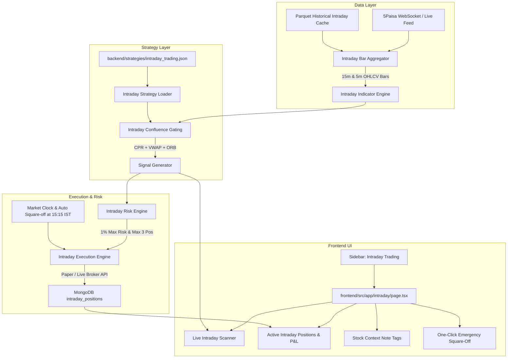

# Implementation Plan: Intraday Trading System (NSE Equity)

## 1. Executive Summary & System Objective

The goal of this initiative is to expand the **Smart Advice** algorithmic platform with a dedicated, institutional-grade **Intraday Trading Engine**. While the existing `Swing_Trading_v2` strategy operates on daily bars targeting multi-day/multi-week momentum compounding, the **Intraday Trading System** targets high-probability, same-day opportunities in liquid NSE large/mid-cap equities.

### Core Tenets
1. **JSON Configuration-Driven**: Full parity with `backend/strategies/swing_trading_v2.json` via a declarative configuration file (`backend/strategies/intraday_trading.json`).
2. **Multi-Timeframe Confluence (15m + 5m)**: 15-minute macro bias (Opening Range & Central Pivot Range) stacked with 5-minute execution triggers (VWAP & EMA pullbacks).
3. **Institutional Confluence Framework**: Trades are only taken when structural filters (CPR), institutional anchors (VWAP), and momentum breakouts (ORB) align.
4. **Zero Overnight Risk & Strict Circuit Breakers**: Mandatory hard square-off at **15:15 IST** (before broker auto-square-off and penalties) and a daily 2% portfolio loss circuit breaker.
5. **Dedicated UI & Modular API**: A new standalone navigation menu, live intraday dashboard, real-time signal monitor with note tags, and dedicated backend endpoints.

---

## 2. System Architecture & Component Diagram



---

## 3. Declarative JSON Strategy Config: `backend/strategies/intraday_trading.json`

The intraday strategy will be defined in a clean JSON format mirroring `swing_trading_v2.json`.

```json
{
  "name": "Intraday_Trading_v1",
  "enabled": true,
  "description": "Institutional multi-timeframe intraday confluence system utilizing ORB (15m), VWAP, and CPR on liquid NSE equities with automated 15:15 IST square-off.",
  "timeframe_config": {
    "macro_timeframe": "15m",
    "execution_timeframe": "5m",
    "market_open_time": "09:15",
    "trading_start_time": "09:30",
    "no_new_entries_time": "14:45",
    "auto_square_off_time": "15:15",
    "market_close_time": "15:30"
  },
  "stock_universe_filters": [
    {
      "type": "volume",
      "op": ">=",
      "value": 500000,
      "description": "High liquidity only (average 500k daily volume to eliminate slippage)"
    },
    {
      "type": "market_cap",
      "op": ">=",
      "value": 5000.0,
      "description": "NSE 200 large/mid-cap equities"
    },
    {
      "type": "price",
      "op": "between",
      "min": 100.0,
      "max": 10000.0
    },
    {
      "type": "atr_pct",
      "op": ">=",
      "value": 1.2,
      "description": "Minimum daily ATR of 1.2% to ensure adequate intraday movement"
    }
  ],
  "intraday_gates": {
    "MARKET_HOURS_GATE": {
      "enabled": true,
      "params": {
        "allow_entries_after": "09:30",
        "block_entries_after": "14:45",
        "observe_opening_range_mins": 15
      }
    },
    "CPR_GATE": {
      "enabled": true,
      "params": {
        "require_cpr_alignment": true,
        "narrow_cpr_threshold_pct": 0.4,
        "skip_trading_if_super_wide_cpr": true
      }
    },
    "VWAP_GATE": {
      "enabled": true,
      "params": {
        "require_price_above_vwap_for_long": true,
        "require_price_below_vwap_for_short": true,
        "max_distance_from_vwap_pct": 1.2
      }
    },
    "VOLATILITY_GATE": {
      "enabled": true,
      "params": {
        "min_5m_atr": 1.0,
        "max_5m_atr_pct": 2.5
      }
    }
  },
  "entry_patterns": [
    {
      "name": "orb_15m_breakout",
      "enabled": true,
      "opening_range_minutes": 15,
      "candle_close_confirmation": true,
      "volume_surge_multiplier": 1.5,
      "require_vwap_support": true
    },
    {
      "name": "vwap_pullback_rejection",
      "enabled": true,
      "max_distance_from_vwap_pct": 0.35,
      "reversal_candle_types": ["hammer", "bullish_engulfing", "pin_bar"],
      "rsi_5m_range": [42, 65]
    },
    {
      "name": "cpr_breakout_and_retest",
      "enabled": true,
      "breakout_pivot": "TC",
      "retest_confirmation_required": true
    },
    {
      "name": "ema_9_21_momentum_cross",
      "enabled": true,
      "supertrend_confirmation": true,
      "adx_5m_min": 20
    }
  ],
  "exit_rules": {
    "stop_loss_type": "ATR_OR_PIVOT",
    "atr_stop_multiplier": 1.2,
    "max_stop_loss_pct": 1.0,
    "target_1_multiplier": 1.8,
    "target_1_sell_pct": 0.50,
    "target_2_multiplier": 3.0,
    "breakeven_at_target_1": true,
    "trail_stop_vwap": true,
    "time_exit": {
      "mandatory_square_off": "15:15",
      "order_type": "MARKET"
    }
  },
  "risk_management": {
    "max_positions": 3,
    "capital_allocation_pct": 30.0,
    "risk_per_trade_pct": 0.8,
    "max_daily_loss_pct": 2.0,
    "max_consecutive_losses": 2,
    "pause_trading_after_two_losses": true
  }
}
```

---

## 4. Backend API & Engine Architecture

### 4.1 New Backend Endpoints (`backend/routes/intraday_routes.py`)

| Method | Endpoint | Description |
| :--- | :--- | :--- |
| `GET` | `/intraday/status` | Current market clock status, trading phase, day P&L, square-off countdown |
| `GET` | `/intraday/config` | Reads `intraday_trading.json` strategy configuration |
| `PATCH` | `/intraday/config` | Updates parameters in `intraday_trading.json` from the UI |
| `GET` | `/intraday/signals` | Live candidates passing ORB + VWAP + CPR confluence |
| `GET` | `/intraday/positions` | Active open intraday positions with current P&L, SL, and Target |
| `POST` | `/intraday/start` | Starts the intraday polling/WebSocket scanner loop |
| `POST` | `/intraday/stop` | Pauses/stops new intraday scans |
| `POST` | `/intraday/square-off-all` | Immediate emergency market square-off for all open intraday positions |

### 4.2 Backend Service Modules

1. **`backend/scripts/intraday_indicators.py`**:
   - Calculates **CPR** (Central Pivot Range) from previous day:
     $$\text{Pivot} = \frac{H + L + C}{3}, \quad \text{BC} = \frac{H + L}{2}, \quad \text{TC} = (\text{Pivot} - \text{BC}) + \text{Pivot}$$
   - Calculates **Intraday VWAP**:
     $$\text{VWAP} = \frac{\sum (\text{Price} \times \text{Volume})}{\sum \text{Volume}}$$
   - Calculates **Opening Range (ORB)**: 15-minute high/low between 09:15 and 09:30 IST.
2. **`backend/scripts/intraday_engine.py`**:
   - Manages live position lifecycle with millisecond tracking.
   - Monitors price vs. 1.2x ATR stop loss and Target 1 (1.8x ATR).
   - Enforces automatic market order execution at exactly **15:15 IST**.
3. **`backend/scripts/intraday_scanner.py`**:
   - Scans liquid universe on every new 5-minute candle close.
   - Evaluates gates (Market Hours, CPR width, Price > VWAP).
   - Generates qualified BUY signals with setup tags and risk boundaries.

---

## 5. Frontend UI Specifications

### 5.1 Sidebar Integration (`frontend/src/app/components/Sidebar.tsx`)
- Add a new primary menu item:
  - **Label**: `Intraday Trading`
  - **Href**: `/intraday`
  - **Icon**: `BoltIcon` or `ClockIcon`
  - **Badge**: `LIVE` (during 09:15–15:30 IST)

### 5.2 Intraday Page Layout (`frontend/src/app/intraday/page.tsx`)

#### 1. Header & Live Clock Bar
- Real-time IST market clock (e.g. `11:45:20 IST`).
- Session phase badge: `Pre-Market (09:00)` | `Opening Range (09:15–09:30)` | `Active Trading (09:30–14:45)` | `Square-Off Only (14:45–15:15)` | `Closed (15:30)`.
- Emergency Action: Red **"Square Off All Positions"** button with confirmation modal.

#### 2. Intraday KPI Summary
- **Day Realized P&L**: Net profit/loss from completed intraday trades today.
- **Unrealized P&L**: Live mark-to-market across active intraday positions.
- **Capital Deployed**: Current margin utilization (max 3 positions).
- **Daily Risk Meter**: Visual progress bar showing consumed risk vs. 2.0% daily circuit breaker.

#### 3. Active Intraday Positions Table
Columns:
- `Symbol` + Quantity
- `Pick Context Tag`: e.g. `[ORB Breakout]`, `[VWAP Rejection]`, `[CPR Retest]` (using `StockPickNoteTag`)
- `Entry Price`
- `Current Price`
- `Stop Loss` (1.2x ATR)
- `Target 1 & 2`
- `Unrealized P&L` (% and ₹)
- `Time in Trade`
- `Action`: Single-click "Close Position" button

#### 4. Live Intraday Scanner & Signal Feed
Columns:
- `Stock Symbol` + Company Name
- `Setup / Note Tag`: Instant context badge explaining why the signal fired
- `Confluence Score`: Stack status (CPR: ✅, VWAP: ✅, ORB: ✅, Volume: 1.8x)
- `Trigger Price`
- `Recommended SL & Target`
- `Action`: "Execute Paper Trade"

---

## 6. Implementation Checklist & Phased Roadmap

### Phase 1: Configuration & Core Indicators (Day 1)
- [ ] Create `backend/strategies/intraday_trading.json` with gates, ORB, VWAP, CPR, and risk controls.
- [ ] Implement `backend/scripts/intraday_indicators.py` (vectorized calculation of CPR, intraday VWAP, ORB 15m/30m).
- [ ] Add unit tests in `backend/tests/test_intraday_indicators.py`.

### Phase 2: Engine & Risk Management (Day 2)
- [ ] Build `backend/scripts/intraday_engine.py` with 15:15 IST auto-square-off daemon.
- [ ] Implement 2% daily loss circuit breaker and position sizing formula.
- [ ] Create MongoDB collection `intraday_positions` in `backend/database.py`.

### Phase 3: Backend REST APIs & Handlers (Day 3)
- [ ] Create `backend/handlers/intraday_handler.py`.
- [ ] Create `backend/routes/intraday_routes.py` and register blueprint in `backend/app.py`.
- [ ] Test all endpoints via curl and pytest.

### Phase 4: Frontend Intraday Dashboard (Day 4)
- [ ] Add "Intraday Trading" link in `frontend/src/app/components/Sidebar.tsx`.
- [ ] Add API client methods in `frontend/src/lib/api.ts`.
- [ ] Build `frontend/src/app/intraday/page.tsx` with live clock, KPI cards, positions table, signal feed, and emergency square-off.
- [ ] Integrate `StockPickNoteTag` into intraday tables for instant setup context.

### Phase 5: Verification & Paper Testing (Day 5)
- [ ] Run paper test during market hours (09:30–15:15 IST) simulating ORB and VWAP setups.
- [ ] Verify automatic 15:15 IST square-off and database logging.
- [ ] Document final operating procedures in `AGENT.md`.
